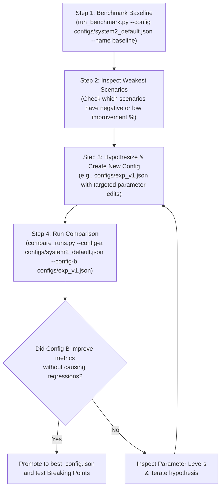

# 🚁 Autonomous Drone System-1 + System-2 Evaluation & Fine-Tuning Guide

> **Target Audience:** Autonomous AI Agents and Human Control Engineers.  
> **Mission:** Systematically tune, benchmark, and optimize System-2 (LLM Meta-Controller) parameters against baseline System-1 (L1 Adaptive Controller) to maximize flight stability, recovery speed, and survivability under severe physical chaos.

---

## Table of Contents

1. [Architecture & Evaluation Thesis](#1-architecture--evaluation-thesis)
2. [File Locations & Quickstart](#2-file-locations--quickstart)
3. [The 4 Evaluation CLI Commands](#3-the-4-evaluation-cli-commands)
   - [A. Run Full Benchmark Suite (`run_benchmark.py`)](#a-run-full-benchmark-suite-run_benchmarkpy)
   - [B. Find Hero Breaking Points (`run_breaking_point.py`)](#b-find-hero-breaking-points-run_breaking_pointpy)
   - [C. Compare Two Configs / Runs Side-by-Side (`compare_runs.py`)](#c-compare-two-configs--runs-side-by-side-compare_runspy)
   - [D. Automated Grid Search Optimizer (`run_grid_search.py`)](#d-automated-grid-search-optimizer-run_grid_searchpy)
4. [Step-by-Step Agent Tuning Protocol](#4-step-by-step-agent-tuning-protocol)
5. [Tuning Levers & Physical Effects Reference](#5-tuning-levers--physical-effects-reference)
6. [Scenario Reference & Extensibility](#6-scenario-reference--extensibility)
7. [Interpreting Dashboards & Demo Presentation](#7-interpreting-dashboards--demo-presentation)

---

## 1. Architecture & Evaluation Thesis

* **System-1 (500 Hz Reflex Loop):** Runs SE(3) geometric tracking + L1 adaptive disturbance rejection in compiled C. Fast, high-frequency, but has **fixed gains and zero semantic awareness** of root causes.
* **System-2 (Async LLM Meta-Controller):** Reasons over 1.0s telemetry summaries, identifies root causes (e.g. broken rotor vs crosswind vs swinging cargo), and hot-swaps targeted control patches (feedforward force offsets, gain multipliers, motor trims, safety envelopes).

### The Evaluation Objective
Prove through rigorous quantitative metrics and visual benchmarks that:
1. **System-1 + System-2 achieves significantly lower tracking error** than System-1 alone across diverse disturbances.
2. **System-1 + System-2 survives high-severity chaos where System-1 alone crashes** (the *"Hero Demo"*).

---

## 2. File Locations & Quickstart

```
system1-system2-runtime/
│
├── configs/
│   ├── system2_default.json            # Baseline default configuration
│   ├── system2_tuned_template.json     # Pre-tuned reference configuration
│   └── best_config.json                # Optimal config generated by optimizer
│
├── evals/
│   ├── run_benchmark.py                # Multi-scenario automated benchmark sweep
│   ├── run_breaking_point.py           # Locates crash thresholds (S1 crash vs S2 fly)
│   ├── run_grid_search.py              # Automated parameter sweep optimizer
│   └── compare_runs.py                 # Side-by-side config and run comparator
│
├── results/
│   ├── runs/                           # Archived JSON runs and standalone HTML dashboards
│   │   ├── <run_name>.json
│   │   └── <run_name>.html
│   └── summary/
│       ├── benchmark_report.json       # Latest benchmark aggregate JSON
│       ├── benchmark_dashboard.html    # Latest interactive visual dashboard
│       └── config_comparison.html     # Latest A/B comparison report
│
└── src/runtime/evals/                  # Evaluation engine core
    ├── scenarios.py                    # Extensible scenario registry & auto-discovery
    ├── metrics.py                      # 12 core flight dynamics metrics
    ├── eval_harness.py                 # Headless 500 Hz simulation runner
    ├── benchmark_suite.py              # Statistical aggregation & A/B testing
    ├── report_generator.py             # HTML/SVG dashboard generator
    └── comparator.py                   # Configuration diff & delta analytics
```

---

## 3. The 4 Evaluation CLI Commands

### A. Run Full Benchmark Suite (`run_benchmark.py`)

Executes a full matrix across scenarios and severities ($0.5\times, 1.0\times, 1.5\times, 2.0\times$).

```bash
# 1. Benchmark a specific configuration and save with a descriptive name:
uv run python evals/run_benchmark.py --config configs/system2_default.json --name run_baseline

# 2. Benchmark your tuned configuration:
uv run python evals/run_benchmark.py --config configs/system2_tuned_template.json --name run_tuned_v1

# 3. Quick test on a single scenario for fast iteration:
uv run python evals/run_benchmark.py --scenario microburst_wind --severity 1.0 --duration 3.0

# 4. Use live LLM API (Groq/Baseten/etc.) instead of deterministic patcher:
uv run python evals/run_benchmark.py --config configs/system2_default.json --live-llm
```

**Artifacts Generated:**
* Terminal summary table with win rates and improvement percentages.
* Machine-readable JSON: `results/runs/<name>.json` (contains complete config snapshot + metrics).
* Interactive HTML dashboard: `results/runs/<name>.html` and `results/summary/benchmark_dashboard.html`.

---

### B. Find Hero Breaking Points (`run_breaking_point.py`)

Finds the critical failure threshold where **System-1 crashes, but System-1+2 keeps flying**.

```bash
# Test chipped propeller failure threshold from 0.5x to 2.0x severity:
uv run python evals/run_breaking_point.py --scenario chipped_propeller --min-sev 0.5 --max-sev 2.0 --step 0.25

# Test crosswind threshold up to 3.5x severity:
uv run python evals/run_breaking_point.py --scenario microburst_wind --min-sev 1.0 --max-sev 3.5 --step 0.5
```

**What to look for in output:**
```
🌟 HERO DEMO WINDOW: Between 1.25x and 1.50x severity, S1 crashes while S1+S2 flies!
• System-1 Crash Severity Limit:       1.25x (💥 CRASHED)
• System-1 + System-2 Crash Limit:     1.50x (Flies stably)
• Survivability Authority Gain:        +0.25x severity
```
> [!TIP]
> This Hero Window is your **#1 hackathon demonstration proof point**.

---

### C. Compare Two Configs / Runs Side-by-Side (`compare_runs.py`)

Compares two configurations, automatically computing the parameter diff and the performance delta per scenario.

#### Option 1: Compare two pre-computed runs
```bash
uv run python evals/compare_runs.py results/runs/run_baseline.json results/runs/run_tuned_v1.json
```

#### Option 2: Benchmark and compare two config JSON files on the fly
```bash
uv run python evals/compare_runs.py \
  --config-a configs/system2_default.json \
  --config-b configs/system2_tuned_template.json \
  --duration 2.5
```

**What it produces:**
1. **Parameter Diff Table:** Lists all modified parameters (e.g., `ramp_duration_s: 0.0 -> 0.3`).
2. **Delta Table:** Shows position error Config A vs Config B, delta %, and winner per scenario.
3. **Interactive Comparison Dashboard:** `results/summary/config_comparison.html`.

---

### D. Automated Grid Search Optimizer (`run_grid_search.py`)

Searches parameter permutations to discover the optimal configuration for a scenario:

```bash
# Optimize trigger sensitivity, ramp durations, and cooldowns for chipped propeller:
uv run python evals/run_grid_search.py --scenario chipped_propeller --duration 2.0 --output configs/best_config.json

# Optimize for compound failure stress:
uv run python evals/run_grid_search.py --scenario compound_stress --duration 2.5 --output configs/tuned_compound.json
```

---

## 4. Step-by-Step Agent Tuning Protocol

When an AI Agent or engineer is tasked with tuning:



### Detailed Loop:
1. **Establish Baseline:**
   ```bash
   uv run python evals/run_benchmark.py --config configs/system2_default.json --name baseline
   ```
2. **Identify Bottlenecks:**
   Review `results/summary/benchmark_dashboard.html` to see which scenarios lagged.
   * *Example:* If high-frequency sensor noise caused oscillation, attitude gains may be too high or ramp duration too abrupt.
3. **Draft Candidate Configuration:**
   Copy `configs/system2_default.json` to `configs/exp_trial.json` and adjust parameters.
4. **Compare Candidate vs Baseline:**
   ```bash
   uv run python evals/compare_runs.py --config-a configs/system2_default.json --config-b configs/exp_trial.json
   ```
5. **Verify Breaking Points:**
   Confirm that the candidate maintains or improves survivability limits on `chipped_propeller` and `microburst_wind`.

---

## 5. Tuning Levers & Physical Effects Reference

| Parameter Path | Recommended Search Range | Default | Physical Impact & Advice |
|---|---|---|---|
| `trigger.pos_error_threshold` | `[0.15, 0.20, 0.25, 0.30]` m | `0.30` | Lowering to `0.18-0.20m` alerts S2 earlier before large drift develops. Too low (<0.12m) causes false triggers during normal maneuvering. |
| `trigger.force_residual_threshold` | `[1.5, 2.0, 2.5, 3.0]` N | `3.0` | Measures L1 observer innovation. Lowering to `1.8-2.0N` detects wind gusts *before* position error even grows. |
| `patch.ramp_duration_s` | `[0.0, 0.15, 0.25, 0.35]` s | `0.0` | `0.0` = instant step injection. Setting `0.20-0.30s` provides a smooth linear fade-in, eliminating actuator shock in high winds. |
| `patch.confidence_scaling` | `[True, False]` | `False` | When `True`, scales feedforward and trims by LLM confidence score ($0.0 \dots 1.0$), protecting against hesitant predictions. |
| `worker.cooldown_s` | `[0.8, 1.2, 1.5, 2.0]` s | `2.0` | Minimum interval between LLM calls. Lowering to `1.0-1.2s` allows faster second-shot adjustments during multi-stage disturbances. |
| `patch.motor_trim_clamp_max` | `[1.5, 2.0, 2.5]` | `2.0` | Upper limit on individual rotor scaling. Prevents demanding thrust beyond motor limits. |
| `inference.temperature` | `[0.0, 0.05, 0.2]` | `0.2` | Set to `0.0` or `0.05` with `inference.seed = 42` for scientific, repeatable benchmarking. |

---

## 6. Scenario Reference & Extensibility

All scenarios in `runtime.chaos.presets` are **auto-discovered** into the eval suite:

| Scenario ID | Name | Physical Perturbations | What System-2 Fixes |
|---|---|---|---|
| `chipped_propeller` | Chipped Propeller | Motor 1 at 40% thrust + blade flutter | Boosts M1 trim (`1.4-1.6x`) to eliminate asymmetric roll/pitch torque. |
| `microburst_wind` | 6.5N Crosswind Microburst | 6.5N steady +X force + 0.8N Dryden turbulence | Injects opposing feedforward force (`Fx = -6.5N`) to cancel wind bias. |
| `tethered_cargo_wind` | Tethered Cargo in Wind | 0.35kg swinging pendulum mass + aero drag | Softens attitude rate gains (`att_kp = 0.45`) to decouple from pendulum resonance. |
| `sensor_chatter` | Severe IMU Sensor Chatter | 0.85 rad/s gyro noise + 85 Hz vibration | Reduces rate gains to prevent control chatter from amplifying sensor noise. |
| `compound_stress` | Compound Stress Test | Motor 1 at 50% + 5.0N wind + swinging cargo | Simultaneously coordinates motor trims, wind feedforward, and gain softening. |

### Adding a New Scenario (Future Extensibility)
Adding a new failure mode requires **no changes** to evaluation scripts:
1. Add the preset to `runtime.chaos.presets.CHAOS_PRESETS`.
2. It is automatically available across `run_benchmark.py`, `run_breaking_point.py`, and `compare_runs.py`.

---

## 7. Interpreting Dashboards & Demo Presentation

### Viewing Dashboards
```bash
# Open the latest benchmark report:
open results/summary/benchmark_dashboard.html

# Open the latest configuration comparison:
open results/summary/config_comparison.html
```

### Key Metrics for Judges & Presentations:
1. **Position Error Improvement %:** Headline percentage showing tracking precision gain ($+50\%$ to $+90\%$).
2. **Hero Window:** Highlight the exact severity where System-1 crashes but System-1+2 recovers and holds hover.
3. **Recovery Speedup:** Factor ($2\times - 4\times$) showing how much faster flight stability is restored after disturbance onset.
4. **Safety Score:** Composite metric ($0-100$) penalizing tilt departures and crashes.

---

## 8. Verification & Test Suite

Before finalizing any new configuration or eval script changes, run the test suite:

```bash
uv run python -m unittest discover tests
```
*Expected: 56/56 unit tests passing.*
