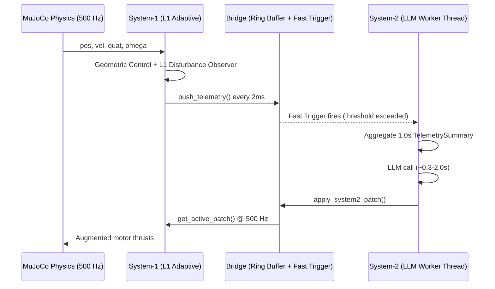
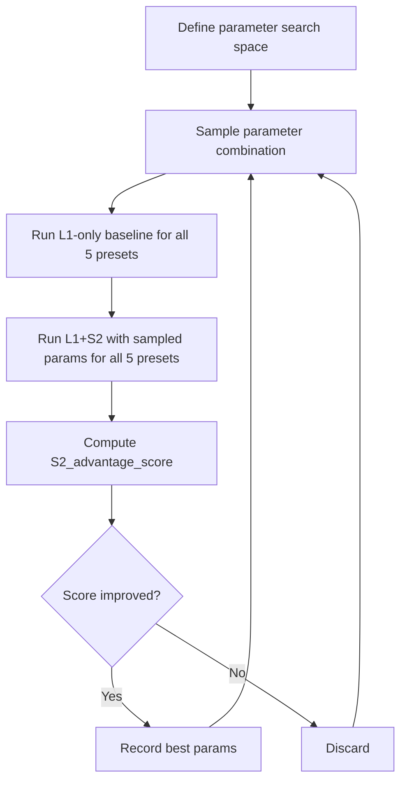

# 🎛️ System-2 (LLM) Tuning Guide: Making S1+S2 Outperform S1-Only (L1 Adaptive)

> **Goal**: Systematically tune every configurable parameter so that  
> **System-1 (L1 Adaptive) + System-2 (LLM)** demonstrably outperforms  
> **System-1 (L1 Adaptive) alone** across all chaos presets, both visually  
> in the dual-drone MuJoCo simulation and numerically on benchmark evaluations.

---

## ⚡ Unified Configuration Hub (Single Place to Tweak Everything)

All System-2 parameters and coordination interfaces have been centralized into a dedicated, cohesive configuration architecture:

- **Master Python Config**: [`src/runtime/config/system2_config.py`](file:///Users/anuragkodle/Desktop/meta-hackathon/system1-system2-runtime/src/runtime/config/system2_config.py) (importable via `from runtime.config import System2MasterConfig`)
- **Default Baseline JSON**: [`configs/system2_default.json`](file:///Users/anuragkodle/Desktop/meta-hackathon/system1-system2-runtime/configs/system2_default.json) (exact current baseline parameters)
- **Tuned Exploration Template**: [`configs/system2_tuned_template.json`](file:///Users/anuragkodle/Desktop/meta-hackathon/system1-system2-runtime/configs/system2_tuned_template.json) (pre-configured for benchmarking exploration)

### Quick Usage:
```bash
# 1. Run 3D side-by-side simulation with a custom System-2 configuration:
uv run mjpython src/runtime/sim/view_dual_drone.py --s2-config configs/system2_default.json

# 2. Run automated headless evaluation with a custom System-2 configuration:
uv run python src/runtime/sim/demo_llm_impact.py wind_gust --config configs/system2_default.json
```

```python
from runtime.config import System2MasterConfig

# Programmatic tweaking for automated grid-search or Bayesian optimization:
cfg = System2MasterConfig()
cfg.trigger.pos_error_threshold = 0.18        # tighter trigger
cfg.patch.ramp_duration_s = 0.3               # smooth 300ms hot-swap ramp-in
cfg.inference.temperature = 0.05              # deterministic LLM reasoning
cfg.worker.cooldown_s = 1.0                   # faster re-consultation
cfg.save_json("configs/my_experiment.json")
```

---

## Table of Contents

1. [Architecture Recap & Why S2 Must Add Value](#1-architecture-recap--why-s2-must-add-value)
2. [Category A — Fast Trigger Parameters (When S2 Wakes Up)](#2-category-a--fast-trigger-parameters-when-s2-wakes-up)
3. [Category B — Telemetry Summary (What S2 Sees)](#3-category-b--telemetry-summary-what-s2-sees)
4. [Category C — System-2 Worker Lifecycle (How Often & How S2 Acts)](#4-category-c--system-2-worker-lifecycle-how-often--how-s2-acts)
5. [Category D — LLM Prompt Engineering (System Prompt & User Prompt Schema)](#5-category-d--llm-prompt-engineering-system-prompt--user-prompt-schema)
6. [Category E — LLM Output Schema (What S2 Can Command)](#6-category-e--llm-output-schema-what-s2-can-command)
7. [Category F — Patch Application & Lifecycle (How & When the Patch Hits S1)](#7-category-f--patch-application--lifecycle-how--when-the-patch-hits-s1)
8. [Category G — LLM Provider, Model & Inference Tuning](#8-category-g--llm-provider-model--inference-tuning)
9. [Category H — L1 Adaptive Controller Gains (System-1 Baseline)](#9-category-h--l1-adaptive-controller-gains-system-1-baseline)
10. [Category I — Chaos Scenario Calibration (Test Difficulty)](#10-category-i--chaos-scenario-calibration-test-difficulty)
11. [Category J — Simulation Physics & Timing](#11-category-j--simulation-physics--timing)
12. [Suggested Priority Actions (Quick Wins)](#12-suggested-priority-actions-quick-wins)
13. [Automated Benchmarking / Fine-Tuning Strategy](#13-automated-benchmarking--fine-tuning-strategy)
14. [Quick Reference: All Tunable Parameters by File](#quick-reference-all-tunable-parameters-by-file)

---

## 1. Architecture Recap & Why S2 Must Add Value



**The core challenge**: L1 Adaptive already handles most disturbances within milliseconds via its disturbance observer (`sigma_f_hat`, `sigma_M_hat`). For S2 to add value, it must handle situations where:

1. **L1's bandwidth is insufficient** — steady-state offsets, slow drift, or disturbances the LPF bandwidth can't track
2. **L1 can't diagnose root cause** — motor degradation needs different treatment than wind
3. **Gain retuning is needed** — oscillations under noise that L1 can't damp with fixed gains
4. **Proactive safety** — reducing tilt limits before a crash happens

> [!IMPORTANT]
> L1 is already very good. S2 must be **faster to trigger, smarter in diagnosis, and more precise in patching** to show measurable improvement. The parameters below are your levers to achieve that.

---

## 2. Category A — Fast Trigger Parameters (When S2 Wakes Up)

> **File**: [`src/runtime/sim/config.py`](file:///Users/anuragkodle/Desktop/meta-hackathon/system1-system2-runtime/src/runtime/sim/config.py#L138-L142) → `L1Config`  
> **File**: [`src/runtime/sim/bridge.py`](file:///Users/anuragkodle/Desktop/meta-hackathon/system1-system2-runtime/src/runtime/sim/bridge.py#L35-L49) → `System1System2Bridge.__init__`

| Parameter | Current Value | Location | Effect on S2 Advantage | Tuning Direction |
|---|---|---|---|---|
| `pos_error_threshold` | `0.30 m` | `L1Config` / Bridge init | How far drone drifts before S2 wakes up | **↓ Lower to 0.15–0.20m** — S2 should intervene *before* L1-only would visibly drift. Earlier trigger = earlier patch = smaller peak error. |
| `tilt_error_threshold_deg` | `25.0°` | `L1Config` / Bridge init | Tilt angle that triggers S2 | **↓ Lower to 15–18°** — By 25° the drone is already in serious trouble. Catching at 15° gives S2 time to damp before crash. |
| `gyro_rms_threshold` | `3.5 rad/s` | `L1Config` / Bridge init | Angular rate spike threshold | **↓ Lower to 2.0–2.5 rad/s** — Detects oscillation/vibration earlier, especially for sensor noise scenarios. |
| `force_disturbance_threshold` | `3.0 N` | `L1Config` / Bridge init | L1 disturbance estimate threshold | **↓ Lower to 1.5–2.0 N** — S2 can counter wind *before* it causes significant position error. This is the most impactful trigger for wind scenarios. |
| `trigger_cooldown_s` | `0.5 s` | Bridge init | Minimum interval between trigger events stored | Keep at 0.5 or **↓ Lower to 0.3s** — faster trigger refresh when disturbance evolves rapidly. |

> [!TIP]
> **Key Insight**: The single biggest advantage S2 can have over S1-only is **reacting to the L1 force residual** (`sigma_f_hat`). L1 already estimates the disturbance but only uses it for adaptive feedforward within its bandwidth. S2 can use the *magnitude and direction* of `sigma_f_hat` to apply a **persistent feedforward offset** that L1's LPF would attenuate. Lower `force_disturbance_threshold` is the fastest way to show S2 advantage on wind scenarios.

### Suggestion: Add New Trigger Conditions

Currently triggers check 4 conditions. Consider adding:

- **Motor saturation trigger**: If any motor is at 0N or 13N for >50ms → likely actuator failure
- **Velocity magnitude trigger**: If `|vel| > 1.0 m/s` → rapid uncontrolled drift
- **Rate-of-change trigger**: If position error *derivative* is large → catching onset before position error grows
- **Combined trigger scoring**: Instead of OR-logic on thresholds, compute a weighted anomaly score: `score = w1*(pos_err/thresh1) + w2*(tilt/thresh2) + w3*(gyro/thresh3) + w4*(force/thresh4)`. Trigger when `score > 1.0`. This catches compound anomalies that individually are below threshold.

---

## 3. Category B — Telemetry Summary (What S2 Sees)

> **File**: [`src/runtime/sim/bridge.py`](file:///Users/anuragkodle/Desktop/meta-hackathon/system1-system2-runtime/src/runtime/sim/bridge.py#L212-L316) → `get_telemetry_summary()`  
> **File**: [`src/runtime/schemas/telemetry.py`](file:///Users/anuragkodle/Desktop/meta-hackathon/system1-system2-runtime/src/runtime/schemas/telemetry.py#L71-L121) → `format_llm_text()`

### 3.1 Sliding Window Duration

| Parameter | Current Value | Effect | Tuning Direction |
|---|---|---|---|
| `window_seconds` (in `get_telemetry_summary()`) | `1.0 s` | Amount of history LLM reasons over | Try **0.5s for faster scenarios** (wind gust onset) or **1.5s for payload oscillation** (needs full pendulum period). Could make this **adaptive** — shorter window for fast events, longer for slow oscillation. |

### 3.2 Summary Content — What to Add

Currently the summary includes 6 telemetry sections. **Add these to improve LLM diagnosis accuracy**:

| New Field | Source | Why It Helps S2 |
|---|---|---|
| **Position error trend** (slope over window) | `np.polyfit(time, pos_err, 1)` | Tells LLM if error is *growing*, *stable*, or *recovering* — crucial for deciding whether to increase or maintain patch |
| **Motor thrust asymmetry** | `max(ctrl) - min(ctrl)` | Direct signal for motor failure. If M1=6.5N while M2-M4=3.2N, the LLM can immediately diagnose partial motor loss |
| **Peak position error** (max in window, not just mean) | `np.max(pos_err_norms)` | Mean can mask brief spikes; peak error is what causes crashes |
| **Active patch status** | From bridge | Tell the LLM what patch is *currently active* so it can refine rather than restart from scratch |
| **Time since last patch** | From bridge | LLM can judge if current patch is stale or fresh |
| **L1 disturbance direction label** | Dominant axis of `sigma_f_hat` | "Wind pushing +X at 5.2N" is much clearer to the LLM than raw `[5.2, 0.1, -0.3]` |
| **Motor saturation events** | Count of samples where any motor hit 0 or 13N | Tells LLM if actuator limits are being hit — indicates L1 is maxed out |

### 3.3 Summary Format Optimization

| Aspect | Current | Suggested |
|---|---|---|
| **Number precision** | 2 decimal places everywhere | Reduce to **1 decimal for angles and forces** — less noise for LLM to parse |
| **Redundant fields** | Euler AND gyro RMS AND oscillation note | Consider **removing raw Euler angles** (the oscillation note already captures the key info) to reduce prompt tokens |
| **Instantaneous vs mean** | Shows both when they differ | Always show both current and 1s-mean for force disturbance — this shows LLM the trend |
| **Add explicit drift direction labels** | Raw numbers only | Add natural language: `"Drone is drifting +X (downwind) at 0.4 m/s"` — dramatically improves LLM reasoning |

### 3.4 Instantaneous Window for Fast Onset

| Parameter | Current Value | Effect | Tuning Direction |
|---|---|---|---|
| Recent samples window (`samples[-25:]`) | Last 25 samples = 50ms | Captures fast-onset gusts vs 1s mean | **↑ Increase to 50 samples (100ms)** for more stable instantaneous estimate, or **↓ Decrease to 10 samples (20ms)** for faster onset detection |

---

## 4. Category C — System-2 Worker Lifecycle (How Often & How S2 Acts)

> **File**: [`src/runtime/brain/llm.py`](file:///Users/anuragkodle/Desktop/meta-hackathon/system1-system2-runtime/src/runtime/brain/llm.py#L405-L586) → `System2Worker._run_loop()`

### 4.1 Timing & Cooldown

| Parameter | Current Value | Location | Effect | Tuning Direction |
|---|---|---|---|---|
| `cooldown_s` | `2.0 s` | `System2Worker.__init__` | Minimum time between consecutive LLM calls | **↓ Lower to 0.8–1.2s** — faster re-consultation when first patch is insufficient. This is critical: if the LLM gives a wrong patch, 2s cooldown means the drone drifts for 2s before correction. |
| `time.sleep(0.05)` (main loop poll) | `50 ms` | `_run_loop()` bottom | How often worker checks for triggers | **↓ Lower to 20–30ms** — reduces reaction latency by up to 30ms per trigger. |
| `time.sleep(0.1)` (idle polling) | `100 ms` | Multiple places in `_run_loop()` | Sleep during cooldown/warmup | Keep at 100ms (not latency-critical during idle). |
| Warmup skip | `summary.timestamp < 1.0 or samples_count < 200` | `_run_loop()` | Ignores first 1.0s of physics | **Could reduce to 0.5s** — L1 stabilizes within ~0.3s from spawn, so S2 could start monitoring sooner. |

### 4.2 Trigger-to-Patch Decision Thresholds (CASE 1: No Active Patch)

| Parameter | Current Value | Effect | Tuning Direction |
|---|---|---|---|
| `pos_err_norm > 0.30` | `0.30 m` | Position error needed to call LLM | **↓ Lower to 0.15–0.20m** — should match the lowered fast trigger threshold |
| `force_dist_norm > 2.5` | `2.5 N` | Force disturbance to call LLM | **↓ Lower to 1.5N** — call LLM as soon as non-trivial disturbance is detected |
| `moment_dist_norm > 0.35` | `0.35 Nm` | Moment disturbance to call LLM | Keep or **↓ lower to 0.25 Nm** |
| `summary.oscillation_detected` | Boolean | Oscillation triggers LLM | ✅ Good, keep this |

> [!WARNING]
> If you lower all thresholds simultaneously, S2 will trigger on minor perturbations that L1 handles just fine, wasting LLM calls. **The key is calibrating thresholds to the "gap" between what L1 handles well and what it doesn't.** Use benchmarks to find the sweet spot.

### 4.3 Patch Active State Management (CASE 2: Patch Already Applied)

| Parameter | Current Value | Effect | Tuning Direction |
|---|---|---|---|
| Calm hover pos error | `< 0.15 m` | When to clear active patch | **↓ Lower to 0.08–0.10m** — only clear patch when drone is truly back to nominal. Clearing too early causes re-triggering. |
| Calm hover force dist | `< 1.0 N` | When to clear active patch | Keep at 1.0N — disturbance truly gone |
| Calm hover moment dist | `< 0.20 Nm` | When to clear active patch | Keep at 0.20 Nm |
| Patch hold minimum time | `2.5 s` | Minimum time to keep patch before clearing | **↑ Increase to 3.0–4.0s** — gives patch time to fully settle. Premature clearing is a common cause of S2 underperformance. |
| Re-consult divergence threshold | `pos_err > 0.75` | When to re-call LLM for patch revision | **↓ Lower to 0.40–0.50m** — catch failing patches sooner |
| Re-consult minimum age | `patch_age > 6.0 s` | Wait before revising | **↓ Lower to 3.0–4.0s** — LLM latency is ~0.5–1.5s, so a 6s delay is too conservative. After 3s the LLM has fresh data. |
| Oscillation re-consult threshold | `patch_age > 4.0 s` | Wait before oscillation revision | **↓ Lower to 2.5s** |
| Stable monitoring threshold | `pos_err < 0.30` | When to declare patch stable | Keep at 0.30m |

### 4.4 Crash Guard

| Parameter | Current Value | Effect | Tuning Direction |
|---|---|---|---|
| Crash altitude | `alt < 0.20 m` | S2 stops reasoning | ✅ Good |
| Crash tilt near ground | `alt < 0.40 and tilt > 55°` | S2 stops reasoning | ✅ Good |
| Runaway departure | `pos_err > 4.5 m` | S2 stops reasoning | **↓ Lower to 2.5–3.0m** — by 4.5m the drone is gone. Earlier stop saves LLM tokens. |

---

## 5. Category D — LLM Prompt Engineering (System Prompt & User Prompt Schema)

> **File**: [`src/runtime/brain/llm.py`](file:///Users/anuragkodle/Desktop/meta-hackathon/system1-system2-runtime/src/runtime/brain/llm.py#L38-L64) → `SYSTEM_PROMPT`

### 5.1 System Prompt Content

| Aspect | Current | Suggested Change | Impact |
|---|---|---|---|
| **Length** | ~1200 tokens | **Reduce to ~600 tokens** — LLM processes shorter prompts faster and more accurately | Faster latency, less confusion |
| **Physics spec detail** | Lists mass, hover weight, motor Newtons | ✅ Keep — essential for correct force calculation | — |
| **Motor layout** | M1=Rear-Left, M2=Rear-Right, M3=Front-Right, M4=Front-Left | ✅ Keep — crucial for motor trim reasoning | — |
| **Chain-of-thought instruction** | "No reasoning, no chain-of-thought" | For non-reasoning models: keep. **For reasoning models (DeepSeek, Qwen3.8)**: remove this restriction — let the model think in `reasoning_content` while outputting clean JSON in `content` | Better patch quality with reasoning models |
| **Gain multiplier guidance** | "att_kp: 0.40, att_kd: 1.6" for sensor noise | **Add more scenario-specific guidance**: wind → pos_kp boost, motor failure → trim scale, compound → combined approach | Better first-shot accuracy |
| **Feedforward guidance** | "command dFx = -Fx" | ✅ Excellent — keep the explicit sign convention guidance | — |
| **Missing: confidence threshold** | Not mentioned | Add: "Set `confidence: 0.0` if nominal hover, `1.0` if certain. S1 will scale patch by confidence." | Enables graduated patch application |
| **Missing: "do nothing" guidance** | Not mentioned | Add: "If all metrics are nominal (pos_err < 0.05m, force < 0.5N, no oscillation), return all-neutral patch with diagnosis 'Nominal hover, no correction needed.'" | Prevents unnecessary interference |
| **Missing: L1 context** | No mention of L1 adaptive | Add: "System-1 already has an L1 adaptive disturbance observer. Your feedforward should target *steady-state residuals* that L1's bandwidth cannot track (forces persisting >0.5s). For transient gusts <0.3s, L1 handles them automatically." | Prevents S2 from fighting L1 |

### 5.2 User Prompt Schema (Telemetry Text)

| Aspect | Current | Suggested Change | Impact |
|---|---|---|---|
| **Trigger header** | "TRIGGER: reasons (metrics)" | **Add priority tag**: "TRIGGER [SEVERITY: HIGH/MEDIUM/LOW]: ..." | Helps LLM calibrate response magnitude |
| **Previous patch info** | Not included | **Add**: "ACTIVE PATCH: feedforward=[+5.0, 0.0, 0.0]N, applied 2.3s ago" or "NO ACTIVE PATCH" | Critical for refinement calls — LLM needs to know what's already being applied |
| **Error trend** | Not included | **Add**: "Position error trend: GROWING (+0.15 m/s²)" or "STABILIZING (-0.05 m/s²)" | Helps LLM decide urgency |
| **Scenario label** | Not included | **Consider NOT adding** — the LLM should diagnose from telemetry, not be told the answer | Keeps benchmarking honest |

---

## 6. Category E — LLM Output Schema (What S2 Can Command)

> **File**: [`src/runtime/schemas/tier2.py`](file:///Users/anuragkodle/Desktop/meta-hackathon/system1-system2-runtime/src/runtime/schemas/tier2.py)

### 6.1 Current Control Levers

| Lever | Schema Field | Current Bounds | Suggested Changes |
|---|---|---|---|
| Feedforward Force | `feedforward_force_offset: [Fx, Fy, Fz]` | Unbounded | **Add clamping in `from_dict()`**: `clip(each, -10.0, +10.0)` N — prevents LLM hallucination of extreme forces |
| Gain Multipliers | `gain_multipliers: {pos_kp, pos_kd, att_kp, att_kd}` | Unbounded (defaults 1.0) | **Add clamping**: `clip(each, 0.2, 3.0)` — prevent destabilizing gain explosion |
| Motor Trim | `motor_trim_scale: [s1, s2, s3, s4]` | Unbounded | **Add clamping**: `clip(each, 0.3, 2.0)` — prevent motor shutdown or >2x overdrive |
| Safety Envelope | `safety_envelope: {max_tilt_deg, temp_setpoint_offset}` | max_tilt default 25° | **Clamp max_tilt to [5.0, 35.0]°**, clamp setpoint offset to `[-0.5, +0.5]` per axis |
| Confidence | `confidence: float` | Default 1.0, unused | **Actually use it**: Scale patch fields by confidence before applying. `effective_ff = ff * confidence` |

### 6.2 New Control Levers to Add

| New Lever | What It Does | Why It Helps S2 Beat S1-Only |
|---|---|---|
| **`l1_bandwidth_override`**: `{as_v, as_w, lpf1_force, lpf1_moment}` | Lets S2 dynamically retune L1's adaptation speed | Under sensor noise: slow down L1 adaptation (lower `as_v`) to avoid amplifying noise. Under wind: speed up adaptation. This is **the most powerful lever** because it changes L1 itself. |
| **`target_setpoint_override`**: `[x, y, z]` | Absolute target override | Lets S2 command "move 0.3m upwind to anticipate drift" — proactive rather than reactive |
| **`patch_duration_s`**: `float` | How long this patch should remain active | Short patches (1s) for transient gusts, long patches (10s) for sustained wind. Removes guesswork from patch lifecycle. |
| **`emergency_thrust_boost`**: `float` | Multiplier on total collective thrust | If altitude is dropping, a 1.1x thrust boost recovers altitude faster than feedforward Fz alone |

---

## 7. Category F — Patch Application & Lifecycle (How & When the Patch Hits S1)

> **File**: [`src/runtime/sim/system1_controller.py`](file:///Users/anuragkodle/Desktop/meta-hackathon/system1-system2-runtime/src/runtime/sim/system1_controller.py#L154-L183) → patch extraction  
> **File**: [`src/runtime/sim/bridge.py`](file:///Users/anuragkodle/Desktop/meta-hackathon/system1-system2-runtime/src/runtime/sim/bridge.py#L318-L346) → `apply_system2_patch()`

### 7.1 Current Behavior: Instantaneous Hard Switch

Currently, `apply_system2_patch()` atomically replaces the active patch. The next 500 Hz iteration immediately applies full feedforward, full gain multiplier, full trim.

**Problem**: A sudden +5N feedforward step function at 500 Hz causes a transient jolt. If the LLM overestimates the force, the drone overshoots.

### 7.2 Suggested Improvements

| Improvement | Implementation | Impact |
|---|---|---|
| **Smooth patch ramp-in** | Instead of applying `patch` instantly, ramp from 0% to 100% over `ramp_duration` (e.g., 0.3s = 150 steps). `effective_ff = ff * min(1.0, (t - t_applied) / ramp_duration)` | Eliminates transient jolts. Smoother recovery looks better in sim and reduces peak error. |
| **Patch expiration / TTL** | If no new patch arrives within `patch_ttl` seconds (e.g., 8s), auto-decay patch to 0 over 1s. | Prevents stale patches from persisting when disturbance ends and S2 doesn't clear. |
| **Partial patch update** | When S2 sends a new patch while one is active, blend: `new_ff = 0.7 * new_patch.ff + 0.3 * old_patch.ff` | Prevents oscillation between conflicting patches. |
| **Confidence-weighted application** | `effective_ff = ff * patch.confidence` | Low-confidence patches are applied gently; high-confidence patches are applied fully. |
| **Feedforward clamp relative to drone weight** | `|ff| <= 0.8 * total_hover_weight` = 10.4N max | Prevents the LLM from commanding forces that would flip the drone. |

---

## 8. Category G — LLM Provider, Model & Inference Tuning

> **File**: [`src/runtime/brain/llm.py`](file:///Users/anuragkodle/Desktop/meta-hackathon/system1-system2-runtime/src/runtime/brain/llm.py#L107-L201) → `System2Brain.__init__`

### 8.1 Provider & Model Selection

| Provider | Current Default Model | Latency | Quality | Recommendation |
|---|---|---|---|---|
| Groq | `qwen/qwen3.8-27b` | ~0.3–0.8s | Good reasoning | ✅ Best for latency-sensitive benchmarks. Try `llama-3.3-70b-versatile` for higher quality. |
| Baseten | `meta-models/muse-spark-open-1026` | ~0.5–2.0s | Variable | Test with `deepseek-ai/DeepSeek-V3` for better physics reasoning |
| Fireworks | `deepseek-v4p1-flash` | ~0.3–1.0s | Good | ✅ Good balance of speed and quality |
| OpenAI | `gpt-4o-mini` | ~0.5–1.5s | Good JSON adherence | Try `gpt-4o` for highest quality (slower) |

> [!TIP]
> **For benchmarking**: Use the fastest provider (Groq) so S2's *reasoning quality* is isolated from latency penalty. For the visual sim demo, any provider with <1.5s latency works well.

### 8.2 Inference Parameters

| Parameter | Current Value | Location | Tuning Direction |
|---|---|---|---|
| `temperature` | `0.2` | `analyze_and_patch()` | **↓ Try 0.0–0.1** for more deterministic, reproducible patches (critical for benchmarking). Higher temperature → more variability → harder to tune. |
| `max_completion_tokens` (Groq) | `2048` | `analyze_and_patch()` | **↓ Reduce to 512** — the output JSON is <200 tokens. Less budget = faster inference. |
| `max_tokens` (others) | `4096` | `analyze_and_patch()` | **↓ Reduce to 512–1024** — same reason. |
| Structured output / JSON mode | Not used | — | **Enable `response_format={"type": "json_object"}`** where supported (OpenAI, Groq). Eliminates JSON parsing failures. |
| Seed | Not used | — | **Add `seed=42`** for reproducible benchmarks. |
| `top_p` | Not set | — | **Add `top_p=0.9`** to reduce tail distribution randomness. |

---

## 9. Category H — L1 Adaptive Controller Gains (System-1 Baseline)

> **File**: [`src/runtime/sim/config.py`](file:///Users/anuragkodle/Desktop/meta-hackathon/system1-system2-runtime/src/runtime/sim/config.py#L109-L142) → `L1Config`

> [!CAUTION]
> **Do NOT weaken L1 to make S2 look better.** The goal is to show S2 adds value *on top of* a strong L1. If you artificially weaken L1, the benchmarks are meaningless.

### 9.1 Parameters That Affect How Much "Room" S2 Has to Help

| Parameter | Current Value | Effect | Notes |
|---|---|---|---|
| `pos_gains` | `[3.0, 3.0, 15.0]` | Position stiffness | Higher = L1 handles more on its own. Keep at current values. |
| `vel_gains` | `[2.5, 2.5, 8.0]` | Velocity damping | Keep at current values. |
| `att_gains` | `[3.5, 3.5, 1.2]` | Attitude stiffness | Keep at current values. |
| `ang_gains` | `[0.7, 0.7, 0.25]` | Angular rate damping | Keep at current values. |
| `as_v` | `-5.0` | L1 velocity adaptation Hurwitz gain | **More negative = faster adaptation**. At -5.0, L1 tracks moderate disturbances well. The gap S2 can fill is in steady-state forces where the LPF attenuates L1's response. |
| `as_w` | `-20.0` | L1 angular adaptation Hurwitz gain | Fast enough for moments. |
| `lpf1_cutoff_freq_force` | `10.0 Hz` | L1 force compensation bandwidth | This is the **critical parameter**. At 10 Hz, L1 rejects disturbances up to ~10 Hz. Steady wind (0 Hz) should be fully compensated. If L1 isn't fully canceling steady wind, the issue might be in `vtilde_xy_scale` or the LPF bandwidth. |
| `lpf2_cutoff_freq_moment` | `5.0 Hz` | L1 moment compensation bandwidth | Keep at 5.0. |
| `vtilde_xy_scale` | `1.0` | Scales horizontal adaptation error | Try `0.8` if L1 is causing lateral oscillation under tilted flight. |

### 9.2 Where S2 Adds Value Given These L1 Parameters

L1 with these gains handles:
- ✅ Wind gusts (transient, <1s) → L1 rejects within 100–200ms
- ✅ Payload swing (periodic) → L1 tracks disturbance oscillation
- ⚠️ Motor degradation → L1 compensates thrust loss but can't identify *which* motor or apply *optimal* trim
- ⚠️ Sustained strong wind → L1 compensates partially but residual steady-state drift accumulates if LPF attenuates DC component
- ⚠️ Sensor noise → L1 amplifies noise through its adaptation gains
- ❌ Compound failures → L1 has no concept of "multiple simultaneous failures"

**S2's advantage scenarios**: Motor trim, gain retuning under noise, compound failure diagnosis, and residual steady-state feedforward that L1's LPF doesn't fully pass through.

---

## 10. Category I — Chaos Scenario Calibration (Test Difficulty)

> **File**: [`src/runtime/chaos/presets.py`](file:///Users/anuragkodle/Desktop/meta-hackathon/system1-system2-runtime/src/runtime/chaos/presets.py)

### 10.1 Tuning Presets for Maximum S2 Advantage Visibility

| Preset | Current | Tuning to Maximize S2 Value |
|---|---|---|
| **Preset 1**: Motor failure | M1 at 40% | Try **M1 at 30%** — more severe = L1 drifts more = S2's motor_trim is more impactful. Also try M1+M2 combined degradation. |
| **Preset 2**: Wind | 6.5N +X, 0.8N turbulence | Try **8.0N steady + 1.5N turbulence** — pushes L1 to its limits. Or try **multi-axis wind** [5.0, 3.0, 0.0] which L1 handles worse. |
| **Preset 3**: Payload + wind | 0.35kg, 4N wind | Good as-is — payload oscillation is where S2's gain retuning shines. |
| **Preset 4**: Sensor noise | 0.85 rad/s gyro | Try **1.2 rad/s** — forces more aggressive gain damping from S2. |
| **Preset 5**: Compound | M1@50%, 5N wind, cargo | This is the **showcase scenario** for S2. Make it harder: **M1@35%, 7N wind, cargo + sensor noise** — L1-only will visibly struggle while S2 can diagnose and patch all four issues. |

### 10.2 New Presets to Create

| New Preset | Description | Why S2 Wins |
|---|---|---|
| **Gradual motor degradation** | Motor 1 loses 10% thrust per second over 5s | L1 adapts reactively; S2 can detect the trend and pre-adjust trim |
| **Rotating wind** | Wind direction rotates 360° over 10s | L1 lags behind the rotation; S2 can predict and lead with feedforward |
| **Asymmetric payload swing** | Payload mass 0.5kg with offset CG | Forces coupled roll-pitch oscillation that S2's gain retuning handles better |
| **Multi-motor partial failure** | M1@70%, M3@60% | Two simultaneous partial failures — L1 compensates but S2's trim is more precise |

---

## 11. Category J — Simulation Physics & Timing

> **File**: [`src/runtime/sim/config.py`](file:///Users/anuragkodle/Desktop/meta-hackathon/system1-system2-runtime/src/runtime/sim/config.py#L155-L166) → `SimConfig`

| Parameter | Current Value | Effect | Tuning Direction |
|---|---|---|---|
| `physics_timestep` | `0.002 s (500 Hz)` | Physics step rate | ✅ Keep — 500 Hz is standard for quadrotor control |
| `render_fps` | `60.0` | Visual refresh rate | ✅ Keep — only affects visualization |
| `telemetry_print_interval` | `1.2 s` | Terminal log frequency | Lower to `0.5s` for denser debug output during tuning |
| Max substeps per render | `25` | Physics sync cap | ✅ Keep |
| `max_buffer_size` (bridge) | `1500` (3.0s @ 500Hz) | Ring buffer depth | ✅ Sufficient for 1.0s window. **Increase to 2500 (5.0s)** if you want longer windows. |

---

## 12. Suggested Priority Actions (Quick Wins)

These changes will show the **biggest S2 advantage with the least effort**:

### 🥇 Priority 1 — Reduce Trigger & Decision Thresholds (Immediate Impact)

```python
# In L1Config (config.py):
pos_error_threshold: float = 0.18        # was 0.30
force_disturbance_threshold: float = 1.8  # was 3.0
tilt_error_threshold_deg: float = 18.0    # was 25.0
gyro_rms_threshold: float = 2.5           # was 3.5

# In System2Worker._run_loop() (llm.py):
# CASE 1 thresholds:
pos_err_norm > 0.18     # was 0.30
force_dist_norm > 1.8   # was 2.5

# Worker cooldown:
cooldown_s: float = 1.0  # was 2.0
```

### 🥈 Priority 2 — Add Active Patch Context to Prompt

In `telemetry.py:format_llm_text()`, add:
```
- Active S2 Patch: feedforward=[+5.0, 0.0, 0.0]N, gains=[1.0, 1.0, 0.7, 1.4], applied 2.3s ago
```
Or: `- Active S2 Patch: NONE (baseline)`

### 🥉 Priority 3 — Implement Patch Ramp-In

In `system1_controller.py`, instead of instant application:
```python
# Ramp factor: 0.0 → 1.0 over 0.3 seconds
ramp = min(1.0, (sim_time - patch.timestamp) / 0.3)
active_ff = active_ff * ramp
```

### 🏅 Priority 4 — LLM Inference Speed

```python
# In analyze_and_patch():
temperature = 0.05       # was 0.2
max_tokens = 512         # was 4096
# Add JSON mode if provider supports it
```

### 🏅 Priority 5 — Patch Clamping (Safety & Correctness)

```python
# In System2Patch.from_dict():
if ff is not None:
    ff = [float(np.clip(x, -10.0, 10.0)) for x in ff]
if trim is not None:
    trim = [float(np.clip(x, 0.3, 2.0)) for x in trim]
if gains:
    gains.pos_kp = float(np.clip(gains.pos_kp, 0.3, 2.5))
    # ... same for other gains
```

---

## 13. Automated Benchmarking / Fine-Tuning Strategy

### 13.1 Metrics to Capture Per Scenario

For each chaos preset, run both **L1-only** and **L1+S2** and record:

| Metric | Formula | Lower = Better? |
|---|---|---|
| **Mean Position Error** (m) | `mean(||pos - target||)` over eval window | ✅ Yes |
| **Max Position Error** (m) | `max(||pos - target||)` over eval window | ✅ Yes |
| **RMS Position Error** (m) | `sqrt(mean((pos-target)²))` | ✅ Yes |
| **Mean Altitude Error** (m) | `mean(|z - z_target|)` | ✅ Yes |
| **Mean Tilt Angle** (°) | `mean(tilt_deg)` | ✅ Yes |
| **Max Tilt Angle** (°) | `max(tilt_deg)` | ✅ Yes |
| **Crash Count** | Number of times `z < 0.15m` | ✅ Yes |
| **Time to Recovery** (s) | Time from chaos injection to `pos_err < 0.10m` | ✅ Yes |
| **Steady-State Error** (m) | Mean error in last 2s of eval window | ✅ Yes |
| **Oscillation Duration** (s) | Total time with `oscillation_detected = True` | ✅ Yes |
| **Motor Saturation %** | % of time any motor at 0 or 13N | ✅ Yes |

### 13.2 Composite Score

```
S2_advantage_score = Σ_i [w_i * (metric_L1_only_i - metric_L1_S2_i) / metric_L1_only_i * 100]
```

Where `w_i` are scenario-specific weights:
- Wind scenarios: weight position error heavily
- Motor failure: weight tilt and crash count heavily  
- Sensor noise: weight oscillation duration heavily
- Compound: equal weights

### 13.3 Automated Tuning Loop



**Parameters to search over** (with ranges):

```python
param_space = {
    # Trigger thresholds
    "pos_error_threshold": [0.10, 0.15, 0.20, 0.25, 0.30],
    "force_disturbance_threshold": [1.0, 1.5, 2.0, 2.5, 3.0],
    "tilt_error_threshold_deg": [12.0, 15.0, 18.0, 22.0, 25.0],
    "gyro_rms_threshold": [2.0, 2.5, 3.0, 3.5],
    
    # Worker timing
    "cooldown_s": [0.5, 0.8, 1.0, 1.5, 2.0],
    "window_seconds": [0.5, 0.75, 1.0, 1.5],
    
    # Decision thresholds
    "needs_attention_pos": [0.12, 0.18, 0.25, 0.30],
    "needs_attention_force": [1.0, 1.5, 2.0, 2.5],
    "calm_hover_pos": [0.05, 0.08, 0.10, 0.15],
    "patch_hold_min_s": [2.0, 3.0, 4.0, 5.0],
    "re_consult_pos": [0.35, 0.50, 0.65, 0.75],
    "re_consult_min_age": [2.0, 3.0, 4.0, 6.0],
    
    # LLM inference
    "temperature": [0.0, 0.05, 0.1, 0.2],
    "max_tokens": [256, 512, 1024],
    
    # Patch application
    "ramp_duration_s": [0.0, 0.1, 0.2, 0.3, 0.5],
    "patch_ttl_s": [5.0, 8.0, 12.0, 20.0],
}
```

### 13.4 Headless Eval Script Structure

Extend [`demo_llm_impact.py`](file:///Users/anuragkodle/Desktop/meta-hackathon/system1-system2-runtime/src/runtime/sim/demo_llm_impact.py) into a full benchmarking harness:

```python
def benchmark_scenario(preset_key, params, n_runs=3):
    """Run L1-only and L1+S2 for a preset, return metrics dict."""
    results_l1 = [run_headless("l1_adaptive", preset_key, duration=8.0) for _ in range(n_runs)]
    results_s2 = [run_headless("l1_adaptive+system2", preset_key, duration=8.0, **params) for _ in range(n_runs)]
    return {
        "l1_mean_pos_err": mean([r["mean_pos_err"] for r in results_l1]),
        "s2_mean_pos_err": mean([r["mean_pos_err"] for r in results_s2]),
        "advantage_pct": ...,
    }
```

---

## Quick Reference: All Tunable Parameters by File

| Config File / Module | Sub-Configs & Parameters | Count | Primary Purpose |
|---|---|---|---|
| **[`system2_config.py`](file:///Users/anuragkodle/Desktop/meta-hackathon/system1-system2-runtime/src/runtime/config/system2_config.py)** / **[`system2_default.json`](file:///Users/anuragkodle/Desktop/meta-hackathon/system1-system2-runtime/configs/system2_default.json)** | `FastTriggerConfig`, `TelemetrySummaryConfig`, `PatchApplicationConfig`, `System2InferenceConfig`, `System2WorkerConfig`, `System2MasterConfig` | **~45** | **Single central place** to tweak hot-swap apply time, all thresholds, window durations, saturation limits, temperature, tokens, cooldowns, and safety clamps |
| [`config.py`](file:///Users/anuragkodle/Desktop/meta-hackathon/system1-system2-runtime/src/runtime/sim/config.py) | `L1Config` gains; `DroneConfig` mass & mixer matrix; `SimConfig` 500 Hz physics | ~25 | System 1 reflex gains and physics world settings |
| [`bridge.py`](file:///Users/anuragkodle/Desktop/meta-hackathon/system1-system2-runtime/src/runtime/sim/bridge.py) | Ring buffer execution, fast trigger detection, sliding window statistics | — | Wires `trigger_cfg`, `telemetry_cfg`, and `patch_cfg` into 500 Hz loop |
| [`llm.py`](file:///Users/anuragkodle/Desktop/meta-hackathon/system1-system2-runtime/src/runtime/brain/llm.py) | `System2Brain` caller, `System2Worker` background thread loop | — | Wires `inference_cfg` and `worker_cfg` into LLM execution |
| [`system1_controller.py`](file:///Users/anuragkodle/Desktop/meta-hackathon/system1-system2-runtime/src/runtime/sim/system1_controller.py) | `_resolve_active_patch()` with ramp-in apply time and safety clamping | — | Wires `patch_cfg` into L1 and PID reflex loops |
| [`presets.py`](file:///Users/anuragkodle/Desktop/meta-hackathon/system1-system2-runtime/src/runtime/chaos/presets.py) | Chaos scenario intensity parameters (Presets 1..5) | ~20 | Testbed disturbance and failure mode calibration |
| **Total** | | **~98 tunable parameters** | |
